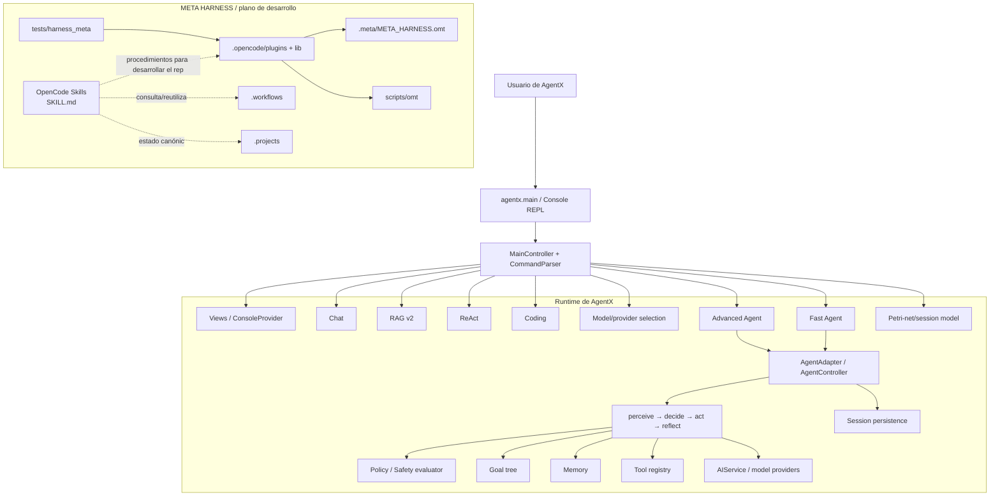
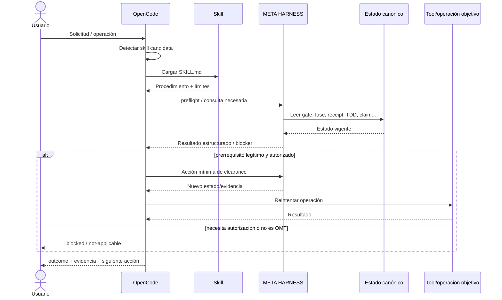
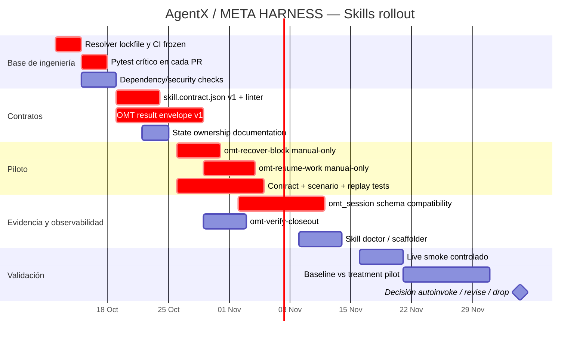
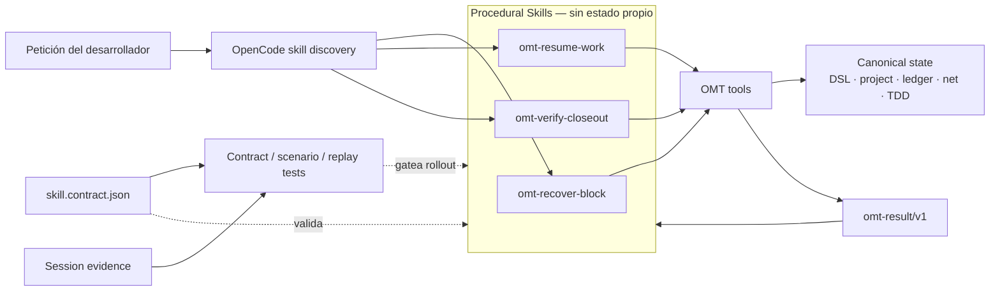

# Revisión técnica de `oikumo/agentx` y de la propuesta de skills para META HARNESS

## Resumen ejecutivo

La revisión se ha realizado sobre el estado de `main` correspondiente al commit **`fef76600c3bb9447b3afb79b11c0dd8c0b5f9112`**, el mismo SHA que figura en el documento adjunto `meta_harness_skills_review_2026-10-11.md`. El intento de clonado local no pudo completarse por una limitación de red/DNS del entorno de ejecución; por ello, el análisis del código se hizo contra ese **commit inmutable** mediante la API/conector de GitHub, inspeccionando estructura y archivos fuente directamente. Esto evita mezclar revisiones de distintas fechas.

La conclusión principal es que el repositorio contiene en realidad **dos sistemas relacionados pero arquitectónicamente distintos**:

1. **AgentX, el producto**, es una aplicación/framework educativo de agentes LLM en Python 3.14, con REPL de consola, chat, RAG, ReAct, coding tools, selección de proveedores, un agente avanzado basado en ciclo `perceive → decide → act → reflect`, persistencia y redes de Petri. Su punto de entrada es `agentx.main:start`; no encontré una API HTTP/FastAPI pública en el snapshot actual. El flujo principal utiliza una arquitectura MVC/“Partner interfaces” con controllers, vistas y modelos desacoplados. fileciteturn33file0L2-L6 fileciteturn36file0L2-L6 fileciteturn24file0L2-L6

2. **META HARNESS/OMT++**, que vive alrededor del producto en `.meta/`, `.opencode/`, `scripts/omt/`, `.workflows/`, `.projects/` y `tests/harness_meta/`, es un sistema de control del proceso de desarrollo para agentes de código. El README lo presenta como un mecanismo de gates, TDD, navegación, conocimiento, receipts, estado, concurrencia mediante Petri nets y análisis de sesiones. No debe confundirse con el runtime del agente que consume un usuario final. fileciteturn30file0L1-L2 fileciteturn34file0L1-L2

La **“skills proposal” sí está disponible**: es el archivo adjunto `meta_harness_skills_review_2026-10-11.md`, titulado *“META HARNESS usefulness review and proposed OpenCode skills”*. La propuesta no diseña plugins/runtime skills para el agente AgentX: propone una **capa de procedimientos reutilizables de OpenCode** sobre META HARNESS, comenzando por `omt-recover-block` y `omt-resume-work`, seguida de `omt-verify-closeout`, `omt-deliver-change`, `omt-session-evidence` y `omt-evaluate-skill`. Esta distinción es esencial para evaluar correctamente sus interfaces, estado y permisos.

Mi valoración de la propuesta es **favorable en dirección y alcance**, especialmente por cuatro decisiones: skills finas y on-demand; reutilización de la autoridad existente en el harness; ausencia de un segundo state store; y rollout basado en evidencia. Además, el enfoque coincide con el modelo oficial de OpenCode: un skill es básicamente un `SKILL.md` descubierto y cargado bajo demanda, con `name`/`description`, archivos auxiliares y permisos para **cargar** el skill. OpenCode reconoce tanto `.opencode/skills/...` como `.agents/skills/...`; el repositorio ya contiene una skill en el segundo formato, mientras que en el snapshot analizado `.opencode/` sólo contiene `lib/` y `plugins/`, por lo que las skills propuestas todavía no están materializadas allí. citeturn11search0turn11search3 fileciteturn31file0L1-L10

La principal mejora que haría a la propuesta es **añadir un contrato verificable, pero sin convertir los skills en un nuevo framework de ejecución**. OpenCode no proporciona a `SKILL.md` una interfaz RPC con `init/invoke/close`, tipos de entrada/salida ni estado propio; el skill se carga como instrucciones. Por ello recomiendo un pequeño `skill.contract.json` o equivalente para tests y tooling del repositorio, declarando trigger, near-misses, dependencias OMT, efectos permitidos, criterios de parada, forma del resultado y ownership de estado. La ejecución y autorización seguirían residiendo en OMT/OpenCode.

Los principales riesgos técnicos encontrados son:

| Riesgo | Severidad | Diagnóstico |
|---|---|---|
| Contrato semántico desigual de las herramientas OMT | **Alta** | El propio estudio documenta casos donde la llamada “completa” a nivel de transporte pero el cuerpo significa rechazo; dificulta automatización segura. |
| Compatibilidad del inspector de sesiones | **Alta** | La propuesta reporta `schema_unsupported` contra la DB OpenCode actual; un skill no puede arreglar por instrucciones una incompatibilidad de schema. |
| CI parcial en PR | **Alta** | El único workflow encontrado ejecuta proofs en push/PR; la suite Python completa indicada sólo se ejecuta en el job nocturno. fileciteturn28file0L1-L10 fileciteturn29file0L1-L6 |
| Reproducibilidad de CI | **Alta** | El workflow usa `uv sync --frozen`, pero `uv.lock` no existe en el snapshot consultado y `.gitignore` contiene `uv.lock`; debe corregirse antes de considerar la CI reproducible. fileciteturn29file0L2-L6 fileciteturn37file0L2-L6 |
| Documentación/test-count drift | **Media** | `README` afirma 2.300+ tests y desglosa 2.085 pytest + 283 Vitest, mientras que `pyproject.toml` comenta una suite pytest de 2.103 tests. fileciteturn34file0L1-L2 fileciteturn33file0L2-L6 |
| Dependencias muy acopladas/versionadas | **Media** | Python ≥3.14 y numerosas versiones exactas de LangChain/LangGraph/vector stores/model providers; sin lockfile visible, los transitivos siguen siendo un problema. fileciteturn33file0L2-L6 |
| Precedencia de secretos/configuración | **Media-Alta** | `load_dotenv(override=True)` hace que `.env` prevalezca sobre variables ya inyectadas en el proceso; es cómodo localmente, pero es una mala propiedad por defecto para CI/contenedores/secret managers. fileciteturn36file0L2-L6 |
| Skills como superficie de instrucciones | **Media-Alta** | Un skill comprometido puede inducir llamadas peligrosas aunque el permiso de OpenCode para *cargar* el skill sea válido; el control de efectos debe seguir siendo tool-level/OMT. citeturn11search0turn8search0 |

La prioridad recomendada no es construir un sofisticado “skill runtime”. Es, en este orden: **reparar la base de CI/reproducibilidad; formalizar el contrato mínimo de skills y resultados OMT; implementar manualmente las dos skills piloto; arreglar la compatibilidad de `omt_session`; añadir contract/integration/replay tests; y sólo después medir autoselección y beneficios**.

## Alcance, método y confiabilidad

La revisión combina cuatro estratos de evidencia.

**Código del repositorio.** Se inspeccionó el snapshot de GitHub fijado a `fef766...`, incluyendo el paquete Python, estructura de tests, `pyproject.toml`, punto de entrada, interfaces del dominio de agente, tipos, controller principal, `.opencode`, `.github/workflows` y documentación del repositorio. Por ejemplo, el package root actual contiene `agent`, `model`, `ui`, `utils` y `main.py`; dentro de `model` aparecen los dominios AI, chat, coding, Petri net, program, RAG/RAG v2, ReAct y session. fileciteturn22file0L1-L10 fileciteturn35file0L1-L10

**Propuesta proporcionada por el usuario.** El archivo adjunto está fechado el **11 de octubre de 2026**, identifica el mismo SHA y presenta una investigación empírica de sesiones reales de OpenCode, seguida de la propuesta de seis skills. Sus métricas históricas y consultas a la base de datos están suficientemente documentadas para ser auditables, pero **no las he vuelto a ejecutar independientemente**, porque la base `/home/oikumo/.local/share/opencode/opencode.db` utilizada por el autor no está presente en este entorno. Por tanto, trato números como “1.758 sesiones históricas”, “49.986 tool records” o “74 passed, 2 skipped” como resultados **reportados por la propuesta**, no como mediciones independientes de esta revisión.

**Documentación oficial de OpenCode.** La documentación actual confirma que OpenCode descubre skills desde `.opencode/skills`, `.agents/skills` y ubicaciones compatibles, carga el cuerpo de Markdown bajo demanda y permite `allow`/`ask`/`deny` a nivel del recurso skill. El frontmatter estandarizado está deliberadamente limitado; campos desconocidos no son un buen lugar para inventar un segundo protocolo implícito. Existe además documentación oficial en español, que he priorizado donde era pertinente. citeturn11search0turn11search3

**Frameworks comparables.** Para evitar comparar AgentX con repositorios casualmente llamados “AgentX”, la comparación se hace contra proyectos abiertos y mantenidos con abstracciones directamente pertinentes: LangGraph, LangChain Deep Agents, OpenAI Agents SDK, Microsoft Agent Framework y CrewAI. En todos esos casos se utilizaron fuentes oficiales del proyecto.

Una limitación metodológica relevante es que **“clonar y ejecutar todo el repositorio” no fue posible aquí**: `git clone` falló con una resolución DNS temporal. No sustituyo esa limitación por la afirmación de que se ejecutó el código. La inspección del código remoto queda, no obstante, ligada a un SHA exacto y por tanto es reproducible. Asimismo, no doy por ciertas las afirmaciones del README cuando contradicen la estructura efectiva: la estructura y workflows del snapshot pesan más que descripciones posiblemente desactualizadas.

Esta precaución ha resultado importante. El `README` actual describe correctamente el producto como una aplicación educativa con REPL, pero contiene también mucha documentación del harness; un análisis que se limitase al README podría concluir erróneamente que ambos constituyen un único runtime. fileciteturn34file0L1-L2

## Arquitectura y estado técnico del repositorio

La arquitectura útil para razonar sobre AgentX es de **dos planos**: runtime del producto y control plane de desarrollo.



El punto de entrada carga `.env`, obtiene el provider de consola, construye `MainController`, crea la vista principal y entra en el REPL. No hay en este flujo un servidor HTTP. fileciteturn36file0L2-L6 El `MainController` registra comandos para `chat`, `rag`, `react`, `coding`, `models`, `agent` y `fast-agent`; mantiene controllers cacheados y usa `SessionManager` para el contexto de sesión. Los modos advanced/fast comparten el engine de agente y crean configuración con `AutonomyLevel.SUPERVISED`, persistencia relativa a la sesión y `sandbox_root` asociado a ésta. fileciteturn39file0L2-L6

El núcleo de agente tiene una abstracción bastante mejor estructurada de lo que podría sugerir el aspecto educativo del proyecto. `IAgentModelPartner` expone explícitamente inicio/reanudación de sesión, envío de objetivos, ejecución de ciclos, policy updates, persistencia, memoria, tools, health checks y aprobación de propuestas; los controllers dependen de estas interfaces y no de implementaciones concretas. Hay interfaces separadas para memory, policy, goal manager, tool registry, safety evaluator, AI service y persistence. fileciteturn24file0L2-L6

El modelo de dominio define además un ciclo de vida explícito para el agente (`INITIALIZING`, `PERCEIVING`, `DECIDING`, `ACTING`, `REFLECTING`, `PERSISTING`, `PAUSED`, `TERMINATED`), niveles de autonomía, tipos de acciones y propuestas, configuración de sensors/actuators/memory/policy/goals/reflection y un `sandbox_root`. fileciteturn25file0L2-L6 Las estructuras de persistencia incluyen `SessionSnapshot`, goal tree, policy store y working context; las propuestas tienen estados como `PROPOSED`, `APPROVED`, `NEEDS_CONFIRMATION`, `REJECTED`, `APPLIED` y `REVERTED`. fileciteturn26file0L2-L6

Eso permite resumir los contratos actuales así:

| Superficie | Contrato efectivo | Estado |
|---|---|---|
| CLI | `agentx = agentx.main:start` | Claro y pequeño. fileciteturn33file0L2-L6 |
| UI/controller | Interfaces MVC++ y controllers por pantalla | Bastante desacoplado; existe deuda histórica visible en comentarios de parity/wiring. fileciteturn39file0L2-L6 |
| Agent facade | `IAgentModelPartner` | Buena superficie de inversión de dependencias. fileciteturn24file0L2-L6 |
| Estado | dataclasses + snapshot + session DB | Estructurado, aunque se observan varias capas de estado distintas. fileciteturn25file0L2-L6 fileciteturn26file0L2-L6 |
| Tools | registry de sensors/actuators + command/result | Mejor definido que una colección arbitraria de callbacks. fileciteturn24file0L2-L6 |
| REST/API | No se encontró servicio HTTP público en el snapshot | No debe documentarse AgentX actual como API-first. |
| Dev harness | `omt_*`, DSL, scripts, workflows, receipts, Petri net | Potente pero considerablemente más complejo que el runtime del producto. fileciteturn34file0L1-L2 |
| Skills | instrucciones OpenCode cargadas bajo demanda | Capa procedural, no runtime de producto. citeturn11search0 |

**Dependencias.** `pyproject.toml` fija Python **≥3.14** y versiones concretas de un stack amplio: Chroma, LangChain, LangChain Community/Ollama/OpenAI/Pinecone/Tavily/Google/NVIDIA/OpenRouter, LangGraph, llama-cpp-python, FAISS, OpenAI, aiohttp y Deep Agents, entre otros. Sólo algunas entradas como NumPy/uuid64 mantienen rangos en vez de un pin exacto. La dependencia explícita de `langgraph==1.2.10` y `deepagents==0.7.5` es particularmente significativa: dos de las mejores ideas externas para estado, durable execution y skills ya están conceptualmente cerca del proyecto. fileciteturn33file0L2-L6

La desventaja es un **grafo de dependencias grande y difícil de mantener**, especialmente con Python 3.14. El propio código suprime globalmente un warning de incompatibilidad Pydantic v1 generado por LangChain en Python 3.14, lo que demuestra que el borde de compatibilidad ya se está sintiendo. fileciteturn36file0L2-L6 En vez de suprimir avisos de toda una categoría indefinidamente, convendría registrar una issue upstream/version matrix y retirar la excepción cuando deje de ser necesaria.

**Tests.** La organización distingue `tests/agentx`, `tests/harness_meta` y `tests/test_sandbox`, además de helpers comunes. fileciteturn32file0L1-L10 `pytest` ejecuta en paralelo con `xdist`, excluye por defecto `opencode_live` y documenta que esos tests reales son lentos. El comentario del `pyproject` habla de una suite pytest de 2.103 casos; el README anuncia 2.085 pytest + 283 Vitest. La discrepancia es pequeña como riesgo funcional, pero grande como indicador de que las cifras de documentación no se generan de la CI. fileciteturn33file0L2-L6 fileciteturn34file0L1-L2

**CI/CD.** Sólo encontré un workflow: `split.yml`. En `push` y `pull_request`, los dos lanes ejecutan `uv sync --frozen` y pruebas de separación; la lane de harness añade Node 24, `npm ci` y `tsc --noEmit`. El job que ejecuta `pytest tests/agentx tests/harness_meta -q` está condicionado a la ejecución programada nocturna. No hay, en ese workflow, jobs de publicación, build de wheel, análisis SAST, auditoría de dependencias, secret scanning complementario, coverage threshold o ejecución de pytest en cada PR. fileciteturn29file0L2-L6

Hay además una inconsistencia inmediata: el workflow usa `uv sync --frozen`; en el snapshot consultado, `uv.lock` no existe vía Contents API y `.gitignore` incluye `uv.lock`. Salvo que la estrategia de lock se haya movido a otro artefacto no descubierto aquí, esta combinación debe tratarse como un **bloqueador de CI reproducible** y comprobarse primero. fileciteturn37file0L2-L6

**Seguridad.** El diseño del agente contiene conceptos adecuados —autonomía supervisada, confirmación de actuators, policy engine, `ISafetyEvaluator`, sandbox root y propuestas con aprobación—, pero un tipo o interfaz no demuestra por sí solo una contención robusta. fileciteturn24file0L2-L6 fileciteturn25file0L2-L6 Merecen especial atención cuatro fronteras:

- `load_dotenv(override=True)` hace que el archivo local gane frente a variables de entorno del proceso. Eso invierte una expectativa habitual en despliegues gestionados y facilita que un fichero del workspace sustituya una credencial inyectada por CI o un secret manager. fileciteturn36file0L2-L6
- La gran cantidad de integraciones LLM/vectoriales incrementa la superficie supply-chain. Sin auditoría automatizada visible en el workflow, la dependencia en pins manuales es insuficiente. fileciteturn33file0L2-L6
- Las GitHub Actions usan referencias por versión mayor (`actions/checkout@v4`, `setup-python@v5`, `setup-node@v4`), razonables operativamente pero inferiores al pin por SHA para un modelo de amenaza de supply chain estricto. fileciteturn29file0L2-L6
- Los nuevos skills son **código de control indirecto**: aunque sean Markdown, pueden ordenar a un agente que ejecute operaciones con efectos. Deben tratarse como superficie privilegiada de cambios y no como documentación inocua. OpenCode puede controlar qué skills se cargan, mientras que la autorización de sus efectos debe residir en las herramientas/gates reales. citeturn11search0turn8search0

## Evaluación de la propuesta de skills

El documento adjunto es sustancialmente mejor que una propuesta genérica de “añadamos skills”. Parte de observaciones del harness, identifica near-misses, define condiciones de parada y propone una progresión deliberadamente pequeña. Su tesis —**usar skills procedurales para ayudar al agente a seleccionar e interpretar la maquinaria existente en lugar de duplicarla**— es técnicamente sólida.

La propuesta plantea, en este orden:

| Skill | Problema que resuelve | Evaluación |
|---|---|---|
| `omt-recover-block` | Diagnosticar un rechazo OMT, ejecutar el prerrequisito legítimo mínimo y reintentar | **Excelente primer piloto.** Entrada/salida observable, casos históricos y poco estado propio. |
| `omt-resume-work` | Reconstruir objetivo, estado, discrepancias y siguiente acción después de pausa/compaction | **Excelente segundo piloto.** Ataca directamente el coste cognitivo del harness. |
| `omt-verify-closeout` | Evitar declarar éxito por un transport-success cuando el resultado semántico fue negativo | **Alta prioridad.** Debería combinarse con una mejora del contrato de resultados, no sólo con prompting. |
| `omt-deliver-change` | Elegir y ejecutar el proceso adecuado para una modificación | **Útil pero peligrosa si crece demasiado.** Correcto aplazarla hasta validar skills pequeñas. |
| `omt-session-evidence` | Investigar sesiones reales de forma reproducible | **Diseño bueno, implementación bloqueada** por la incompatibilidad de schema reportada. |
| `omt-evaluate-skill` | Evaluar una skill con baseline/treatment | **Correcto como fase madura**, no como prerrequisito del primer piloto. |

**Definición.** El uso de `SKILL.md` es compatible con OpenCode. La documentación oficial exige `name` y `description`, admite `license`, `compatibility` y `metadata`, descubre tanto `.opencode/skills/<name>/SKILL.md` como `.agents/skills/<name>/SKILL.md` y carga el contenido sólo cuando hace falta. citeturn11search0turn11search3 Esto valida la decisión del documento de no introducir un nuevo plugin/service para las primeras skills.

El repositorio ya demuestra el patrón compatible mediante `.agents/skills`, mientras que `.opencode` en el snapshot contiene únicamente `lib` y `plugins`; por tanto, **la propuesta es todavía propuesta, no una capa implementada de seis skills**. fileciteturn30file0L1-L2 fileciteturn31file0L1-L10

**Interfaces.** Aquí introduciría una mejora importante. Un `SKILL.md` nativo no tiene una función tipada como:

```text
Invoke(input) -> output
```

La interfaz real es lingüística: descripción → selección → Markdown cargado → agente interpreta el procedimiento. Eso es aceptable para OpenCode, pero insuficiente para **testear rigurosamente** comportamientos como “recuperar un bloqueo” o “no confundir empty pool con proyecto finalizado”.

Recomiendo añadir un contrato declarativo auxiliar que sea validado por el repositorio, no por OpenCode:

```json
{
  "schema_version": "1",
  "id": "omt-recover-block",
  "version": "0.1.0",
  "mode": "procedural",
  "inputs": [
    "attempted_operation",
    "target_path",
    "observed_result",
    "feature_or_task_identity"
  ],
  "requires": [
    "omt_status.preflight"
  ],
  "allowed_effects": [
    "read_harness_state",
    "invoke_existing_authorized_omt_tool",
    "retry_original_operation"
  ],
  "forbidden_effects": [
    "weaken_gate",
    "forge_receipt",
    "expand_scope_without_authority"
  ],
  "state_owner": "external",
  "result_schema": "omt-skill-result/v1",
  "stop_when": [
    "operation_succeeds",
    "same_blocker_survives_legitimate_clearance",
    "authorization_is_required",
    "failure_is_not_an_omt_block"
  ]
}
```

Esto no convierte el skill en una API remota ni duplica el harness. Simplemente vuelve testables las promesas que hoy sólo existen en prosa.

**Lifecycle.** El lifecycle adecuado para estas skills es mucho más pequeño que el de un plugin:



No recomiendo añadir `Init()`/`Close()` a estos skills. El lifecycle real debe ser **discover → authorize-load → load → execute procedure through existing tools → produce result → unload from active context**. OpenCode ya resuelve el descubrimiento/carga y aplica permisos al recurso skill. citeturn11search0 Para componentes runtime de AgentX sí tendría sentido un lifecycle de recursos; Microsoft Agent Framework, por ejemplo, expone explícitamente `open()`/`close()` para agentes y recursos MCP. citeturn9search10 Pero copiar ese patrón a Markdown procedural sería sobreingeniería.

**Estado.** La propuesta acierta al no crear una base de datos de skills. `omt-resume-work` debe leer el estado ya autoritativo: status/preflight, net revision, `PROJECT.md`, `CURRENT_STATE.md`, artifacts y ledger. Un skill debería ser **stateless by default**; cualquier memoria persistente debería pertenecer a un subsistema que ya tenga semántica y ownership.

Esta lección coincide con LangGraph: diferencia deliberadamente los checkpoints de thread —continuidad y recuperación de ejecución— de un store de largo plazo compartido entre threads. citeturn10search1 AgentX debería hacer igualmente explícito qué información pertenece a sesión, proyecto, feature, harness global y skill. Hoy esas categorías existen, pero el contrato se distribuye entre varias superficies.

**Permisos.** La propuesta dice correctamente que cargar un skill no concede nuevas autorizaciones. Esto merece convertirse en una regla formal. Los permisos de OpenCode `allow/ask/deny` deciden si el agente puede acceder al skill; no constituyen una capability sandbox para todo lo que las instrucciones posteriormente intenten ejecutar. citeturn11search0 La defensa debe ser:

```text
permiso de skill
       │
       ▼
¿puede cargar instrucciones?
       │
       ▼
OMT/tool permission/gate
       │
       ▼
¿puede ejecutar este efecto concreto?
```

Es el mismo principio que la documentación del OpenAI Agents SDK aplica a MCP: filtrar herramientas, utilizar credenciales de mínimo privilegio, exigir approval para operaciones sensibles y aplicar guardrails en la ejecución de herramientas. citeturn8search0

**Extensibilidad.** OpenCode admite archivos auxiliares junto a `SKILL.md`; la variante más reciente de su documentación también describe catálogos adicionales. citeturn11search2 Esto permite mantener el body del skill pequeño y mover ejemplos, witnesses y scripts a `references/` y `scripts/`, precisamente la dirección adecuada para un repositorio que ya tiene presión de presupuesto contextual.

El punto en el que discrepo parcialmente de la propuesta es que **no conviene codificar más política en el texto del skill** de la estrictamente necesaria. Los requisitos cambiantes deben resolverse por nombre/consulta contra OMT. La skill debería describir *cómo obtener la autoridad vigente*, no memorizar qué gates existen hoy.

Un patrón aconsejado sería:

```markdown
---
name: omt-recover-block
description: >
  Diagnose an OMT refusal, clear only the specific legitimate prerequisite,
  retry once when justified, and return evidence.
metadata:
  opencode/slash: "true"
  opencode/autoinvoke: "false"
---

## Use when

The most recent attempted operation returned an OMT prerequisite refusal.

## Do not use when

The failure is a compiler/runtime/test error unrelated to OMT.

## Procedure

1. Preserve the original operation, path, feature identity and result.
2. Ask `omt_status.preflight` for that exact operation/path.
3. Treat the current OMT response as authority; do not restate policy from memory.
4. Perform only the smallest authorized clearing action.
5. Retry at most once for the same diagnosed blocker.
6. Return `omt-skill-result/v1`.

## Stop

Stop rather than bypassing when authorization is missing, a gate cannot be
legitimately cleared, or the failure class changes.
```

Esto conserva el atractivo principal de la propuesta: **procedimiento fino, autoridad externa**.

## Comparación con frameworks abiertos relevantes

He seleccionado cinco referencias porque cubren dimensiones distintas y útiles para este repositorio. LangGraph y Deep Agents son especialmente importantes porque **AgentX ya depende de ambos**. OpenAI Agents SDK aporta contratos y guardrails de tools/MCP. Microsoft Agent Framework aporta lifecycle, skills, middleware, sesiones y workflows tipados. CrewAI aporta la separación explícita entre autonomía y flows deterministas. fileciteturn33file0L2-L6

| Framework | Por qué es comparable | Estado/memoria | Tools/skills y permisos | Orquestación/lifecycle | Lección para AgentX |
|---|---|---|---|---|---|
| **LangGraph** | AgentX ya usa LangGraph; es referencia de agentes stateful y long-running | Checkpointers por thread + Store de largo plazo; recuperación y HITL. citeturn10search1turn10search10 | Los nodos/tools participan en un grafo con estado explícito | Durable execution, interrupts, supersteps/checkpoints | Separar claramente estado de ejecución, estado durable y conocimiento global |
| **LangChain Deep Agents** | AgentX ya depende de `deepagents`; es probablemente el análogo más cercano a “harness + skills” | Long-term memory apoyada en LangGraph | Skills reutilizables, filesystem permissions, subagents, HITL. citeturn10search7 | Agent harness opinionated sobre herramientas, planificación y contexto | No reinventar primitives que ya existen; mantener skills como capas modulares |
| **OpenAI Agents SDK** | Referencia compacta de agents/tools/handoffs/guardrails/MCP | Sessions y configuración de estado por run. citeturn8search7 | Filtros allow/block, approvals y guardrails pre/post para tools/MCP. citeturn8search0 | Runner + agents + handoffs; lifecycle MCP gestionado | Separar estrictamente descripción del tool, validación, autorización, ejecución y observabilidad |
| **Microsoft Agent Framework** | Marco completo de agentes, skills, middleware y workflows; integra ideas de AutoGen/Semantic Kernel | Sessions, context providers, persistence; workflows con state/checkpoints. citeturn9search1turn9search6 | Tools, Agent Skills, security/middleware como capabilities separadas | Agents con lifecycle de recursos; grafos con edges/executors y workflows componibles. citeturn9search10turn9search4 | Dar contratos uniformes a componentes y mantener skills separadas de los mecanismos de control |
| **CrewAI** | Contrasta autonomía de crews con flows controlados | Flows mantienen estado para automatización estructurada | Agents con roles/tools; Crews componen tareas/agentes | `Crews` para autonomía; `Flows` para rutas previsibles, condicionales y auditables. citeturn10search2 | Elegir deliberadamente qué decide el modelo y qué debe decidir código determinista |

La comparación más importante no es “qué framework tiene más features”, sino **dónde sitúa cada uno la autoridad**.

LangGraph insiste en hacer explícito el estado y en crear checkpoints en límites razonables; sus guías señalan que nodos más pequeños mejoran recuperación y observabilidad porque los reintentos vuelven al comienzo del nodo. citeturn10search4 Eso refuerza directamente la decisión de comenzar por `recover-block`, `resume-work` y `verify-closeout` en vez de un `omt-do-everything`.

Microsoft Agent Framework formula una separación igualmente útil: un agente es apropiado cuando el trabajo es abierto y el modelo debe decidir; un workflow es preferible cuando el orden tiene que ser explícito. Sus workflows conectan executors mediante edges, mantienen estado y checkpoints y pueden exponerse posteriormente como un agente uniforme. citeturn9search5turn9search6 Esta distinción encaja casi exactamente con AgentX: **META HARNESS es la parte determinista/autoritativa; una skill debe ayudar al LLM a navegarla, no sustituirla**.

CrewAI formula la misma idea como Crews frente a Flows: autonomía para exploración frente a control granular para procesos auditables. citeturn10search2

OpenAI Agents SDK aporta la mejor práctica de seguridad más directamente reutilizable: las operaciones capaces de provocar efectos deben poder filtrarse, requerir approval y pasar guardrails de input/output. Su integración MCP permite filtros estáticos/dinámicos y approvals sensibles, y advierte expresamente que un servidor con herramientas puede actuar usando las credenciales proporcionadas. citeturn8search0 Una skill Markdown no debe convertirse en una vía para saltarse ese tipo de control.

De estas referencias se derivan seis mejores prácticas concretas para AgentX:

| Práctica | Aplicación propuesta |
|---|---|
| Estado explícito y con scope | Distinguir session/project/feature/global; skills sin estado propio salvo justificación |
| Contratos estructurados | Normalizar outcomes OMT y añadir contrato testable a cada skill |
| Checkpoints en límites útiles | Tratar cada clearance/retry/closeout como transición observable, no como mega-procedimiento |
| Least privilege en el punto de efecto | Skill permission ≠ tool permission; gates siguen mandando |
| Determinismo donde hay política | Reglas, autorizaciones y aceptación en código/DSL; LLM interpreta y enruta |
| Observabilidad por defecto | Todo skill devuelve evidencia, blocker/result code y next action, no sólo prosa |

## Recomendaciones priorizadas

La recomendación más importante es **mejorar contratos antes de aumentar autonomía**. El siguiente orden reduce riesgo y permite obtener valor de la propuesta en pocas iteraciones.

| Recomendación | Prioridad | Esfuerzo estimado* | Motivo y criterio de aceptación |
|---|---|---:|---|
| Corregir lock/reproducibilidad de `uv sync --frozen` | **Alta** | **Bajo, 0,5–1 día** | Versionar un lock coherente o cambiar conscientemente la política; checkout limpio debe instalar en CI. |
| Ejecutar unit/contract tests en cada PR | **Alta** | **Bajo, 1–2 días** | La suite crítica no debe esperar al nightly; mantener live/model tests separados. |
| Añadir security/dependency checks a CI | **Alta** | **Bajo-Medio, 1–3 días** | Auditoría de dependencias, secret scan/SAST pertinente y failure policy explícita. |
| Crear `skill.contract.json` v1 + validador | **Alta** | **Medio, 3–5 días** | Todas las skills tienen trigger, near-misses, allowed effects, stop conditions, state owner y result schema. |
| Normalizar resultados de `omt_*` | **Alta** | **Medio-Alto, 5–10 días** | Transport-success no puede confundirse con semantic-success. |
| Implementar `omt-recover-block` manual-only | **Alta** | **Bajo-Medio, 2–4 días** | Pasa witnesses positivos, negativos y bypass tests. |
| Implementar `omt-resume-work` manual-only | **Alta** | **Medio, 3–5 días** | Reconcilia discrepancias sin inventar/reescribir estado. |
| Reparar compatibilidad de `omt_session` con schema actual | **Alta** | **Alto, 1–2 semanas** | Inspector lee DB actual de forma read-only y detecta explícitamente schemas no soportados. |
| Añadir `omt-verify-closeout` tras result envelope | **Media-Alta** | **Medio, 3–5 días** | Cada criterio de aceptación queda ligado a evidencia; no confunde tool transport con outcome. |
| Crear suite de skills: trigger, near-miss, contract, replay | **Alta** | **Medio-Alto, 5–8 días** | Tests deterministas preceden a evaluación con LLM real. |
| Endurecer gestión de secretos/config | **Alta** | **Bajo-Medio, 2–4 días** | `.env` local no debe poder sobreescribir secretos de despliegue por defecto. |
| Añadir `skill doctor` / scaffolder / docs generadas | **Media** | **Medio, 3–5 días** | Crear una skill correcta requiere un único comando y errores accionables. |
| Evaluar autoinvocation sólo tras piloto | **Media** | **Alto, 1–2 semanas de evaluación** | Activarla sólo si near-miss rate y outcome quality están dentro del umbral predeclarado. |
| `omt-deliver-change` | **Media-Baja inicialmente** | **Alto, 1–2 semanas** | Sólo después de demostrar que combina las skills finas sin convertirse en un mega-prompt. |
| `omt-evaluate-skill` completo | **Media** | **Alto, 1–3 semanas** | Requiere que captura, atribución, counters y experiment execution sean fiables. |

\*Estimación para una persona con conocimiento razonable del harness; es una estimación de ingeniería, no una medición del repositorio.

**Contrato de resultado.** Ésta es probablemente la modificación de API con mayor retorno. En lugar de respuestas donde el transport layer puede decir “completed” pero la operación realmente fue denegada, propongo un envelope común:

```ts
type OmtOutcome =
  | "succeeded"
  | "blocked"
  | "not_applicable"
  | "inconclusive"
  | "failed";

interface EvidenceRef {
  kind: "rule" | "receipt" | "test" | "artifact" | "session" | "state";
  id: string;
  summary?: string;
}

interface OmtBlocker {
  gate: string;
  code: string;            // estable y machine-readable
  message: string;         // humano
  remediation?: {
    action: string;
    args?: Record<string, unknown>;
  };
  requiresApproval: boolean;
}

interface OmtResult<T = unknown> {
  schemaVersion: "1";
  ok: boolean;             // true sólo si la operación solicitada consiguió su objetivo
  outcome: OmtOutcome;
  code: string;            // p.ej. "TDD_RED_REQUIRED"
  data?: T;
  blocker?: OmtBlocker;
  evidence: EvidenceRef[];
  retryable: boolean;
  stateRevision?: string;
}
```

Una operación bloqueada debería devolver algo parecido a:

```json
{
  "schemaVersion": "1",
  "ok": false,
  "outcome": "blocked",
  "code": "RECEIPT_REQUIRED",
  "blocker": {
    "gate": "g.receipt",
    "code": "RECEIPT_REQUIRED",
    "message": "A receipt is required before editing this protected target.",
    "remediation": {
      "action": "omt_receipt",
      "args": {"target": "opencode.jsonc"}
    },
    "requiresApproval": false
  },
  "evidence": [
    {"kind": "rule", "id": "g.receipt"}
  ],
  "retryable": true
}
```

La skill deja entonces de tener que interpretar emojis, prefixes o prosa para distinguir fracaso semántico de éxito.

**Contrato de estado.** Conviene documentar ownership explícitamente:

```python
from enum import Enum

class StateScope(str, Enum):
    INVOCATION = "invocation"   # efímero
    SESSION = "session"         # OpenCode / agent session
    FEATURE = "feature"         # TDD, artifacts, receipts
    PROJECT = "project"         # PROJECT.md / CURRENT_STATE.md
    HARNESS = "harness"         # policy, net, canonical DSL

# Los skills NO son un scope.
# Un skill sólo lee/modifica estado a través del owner existente.
```

Éste es un detalle pequeño pero evita que en seis meses aparezcan `.skill-state.json`, logs duplicados y un tercer concepto de “resume”.

**Testing de skills.** No empezaría por pruebas LLM end-to-end. Usaría una pirámide:

| Nivel | Qué comprueba | Ejemplo |
|---|---|---|
| Schema/lint | `SKILL.md`, frontmatter, contract, paths | name == directory; no campos top-level desconocidos |
| Contract | Dependencias y efectos | `recover-block` no puede declarar `scope=all` como remediation genérica |
| Scenario/golden | Input → expected classification/next action | receipt missing, TDD RED, permission missing, compiler error |
| Witness replay | Casos anonimizados derivados de sesiones reales | completed transport + negative semantic result |
| Integration | OpenCode + tools OMT falsos/deterministas | skill llama preflight correcto y preserva identity |
| Live smoke | Runtime real, barato y explícito | manual-only skills sobre casos seleccionados |
| Experiment | Baseline frente a treatment | calidad primero; tiempo/retries/tokens después |

El test crucial no es “¿se cargó el skill?”, sino “**¿llegó a la acción correcta sin debilitar el gate ni repetir trabajo innecesario?**”.

La propuesta adjunta sugiere posteriormente un piloto de cuatro casos × baseline/treatment × tres repeticiones, es decir, **24 trials reales**. Es una buena estructura para detectar regresiones grandes, siempre que se mantengan constantes modelo, revisión, herramientas y estado inicial y que se mida aceptación externamente. No recomendaría gastar esos 24 runs hasta que todos los niveles deterministas anteriores sean verdes.

**Documentación y DX.** Añadiría un comando único:

```text
uv run scripts/omt/skill.py doctor
uv run scripts/omt/skill.py new omt-recover-block
uv run scripts/omt/skill.py test omt-recover-block
uv run scripts/omt/skill.py list
```

`doctor` debería validar descubribilidad OpenCode, YAML, nombre, contrato, enlaces locales, referencias a operaciones OMT existentes, permisos declarados y tests. El resultado debe ser totalmente determinista.

También convendría generar automáticamente una tabla de skills para el README/documentación en lugar de mantener otra lista manual, dado el drift ya observable en los contadores de tests. fileciteturn33file0L2-L6 fileciteturn34file0L1-L2

**Gestión de secretos.** Cambiaría la precedencia actual:

```python
# Desarrollo local:
load_dotenv(override=False)

# Sólo una opción explícita y local debería permitir:
# AGENTX_DOTENV_OVERRIDE=1
```

y separaría configuración de desarrollo de credenciales de runtime. El comportamiento actual con `override=True` está documentado directamente en `main.py`. fileciteturn36file0L2-L6

Finalmente, el repositorio debería resistirse a añadir una abstracción propia de “AgentX Skill Runtime” mientras la necesidad siga siendo procedural. AgentX ya tiene **tools** como runtime capability y OpenCode ya tiene **skills** como instrucciones. Fusionarlos prematuramente crearía dos conceptos superpuestos.

## Hoja de ruta de implementación

Propongo un programa de **ocho semanas**, comenzando el lunes **12 de octubre de 2026**, con gates de salida entre fases. La duración supone una persona principal con soporte ocasional de revisión; la parte experimental puede prolongarse si hay que consumir modelos reales o esperar corpus suficiente.



El roadmap tiene cinco hitos prácticos.

**Base verde — 18 de octubre.** `uv sync --frozen` funciona desde un checkout limpio; los tests imprescindibles de producto/harness se ejecutan en PR; el nightly queda para combinaciones caras/live. El workflow actual ya separa product/harness lanes, así que la solución debe aprovechar esa arquitectura, no reemplazarla. fileciteturn29file0L2-L6

**Contrato estable — 30 de octubre.** Existe `omt-result/v1` y `skill-contract/v1`. Herramientas antiguas pueden disponer de adapters temporales, pero todas las nuevas skills consumen el contrato uniforme. El criterio de salida es que ya no haga falta heurística textual para saber si una operación quedó bloqueada.

**Piloto funcional — 8 de noviembre.** `omt-recover-block` y `omt-resume-work` existen físicamente como skills del proyecto, inicialmente con `opencode/autoinvoke: "false"`. OpenCode soporta expresamente este patrón: la skill sigue disponible manualmente pero no se anuncia automáticamente al modelo. citeturn11search0

**Evidencia fiable — 15 de noviembre.** `omt_session` puede leer el schema vigente o, como mínimo, responde con una negociación/version error machine-readable. No debe existir una “ruta secreta” dentro de la skill que lea SQLite de manera diferente a la herramienta oficial. Esto preserva la tesis de la propia propuesta: la skill interpreta capacidades, no las simula.

**Decisión de rollout — 4 de diciembre.** Sólo entonces se decide si alguna skill entra en autoselección. La decisión debe ser de cuatro estados: **retain, revise, drop o inconclusive**. El objetivo primario es mantener o mejorar la calidad de resultado sin nuevas violaciones; reducción de tokens, tiempo o retries es secundaria.

La arquitectura objetivo al terminar ese roadmap sería deliberadamente pequeña:



El resultado final que recomendaría perseguir no es “más automatización” en abstracto. Es una división de responsabilidades más estricta:

**OpenCode skill:** sabe *qué procedimiento seguir y cuándo detenerse*.

**META HARNESS:** sabe *qué está permitido y cuál es el estado canónico*.

**Tool/plugin:** sabe *cómo realizar una operación concreta y devuelve un contrato estructurado*.

**AgentX runtime:** permanece separado y se ocupa de agentes, herramientas, memoria, políticas y sesiones del producto. fileciteturn24file0L2-L6

**Tests/evidence:** determinan *si el conjunto funciona mejor de verdad*.

Con esa separación, la propuesta adjunta se convierte en una evolución razonablemente de bajo riesgo del harness. Sin ella, el peligro es que una colección inicialmente pequeña de `SKILL.md` termine acumulando copias de policy, estado implícito, parsing de resultados y excepciones de permisos, es decir, exactamente un segundo harness menos verificable que el primero.